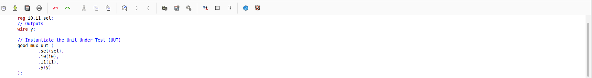
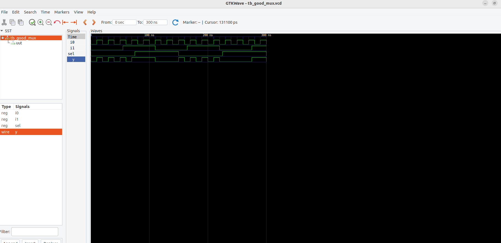
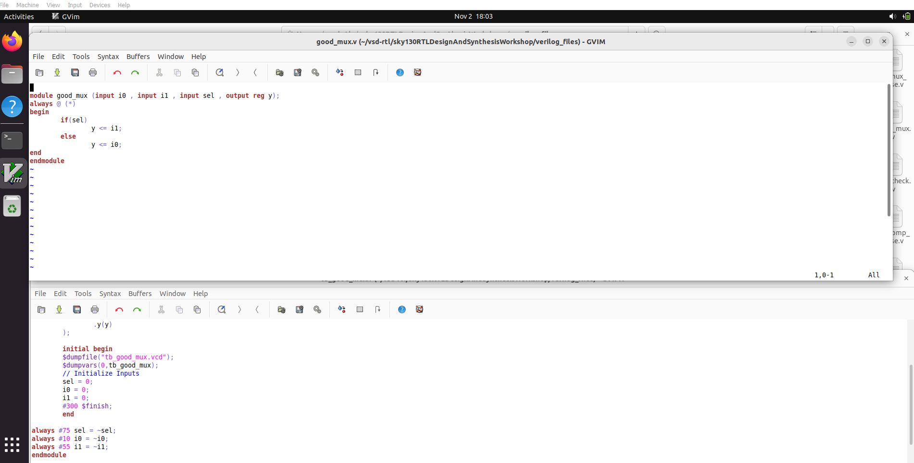

# Lab 2: Design instantiation and GTKWave

**Evidence:** 3 supplied screenshot(s).

## Learning record

The topic is inferred from the uploaded screenshot names and, where available, the terminal logs. The source Verilog files themselves were not included in the ZIP.

## Commands and log evidence

No lab-specific terminal log was supplied. Screenshots document the experiment; no unverified commands have been attributed to this lab.

## Screenshots, in sequence

### 1. Lab2 Design Instantiation

*Evidence: `Lab2_Design_Instantiation.png`*

### 2. Lab2 GTKWave

*Evidence: `Lab2_GTKWave.png`*

### 3. Lab2 files

*Evidence: `Lab2_files.png`*

## Observations and interpretation

- Focus: Design instantiation and GTKWave.
- Screenshots and raw logs are retained as experimental evidence.
- Cell-level or waveform-specific results should be checked directly against the screenshots; no pass/fail result has been inferred from filenames alone.
