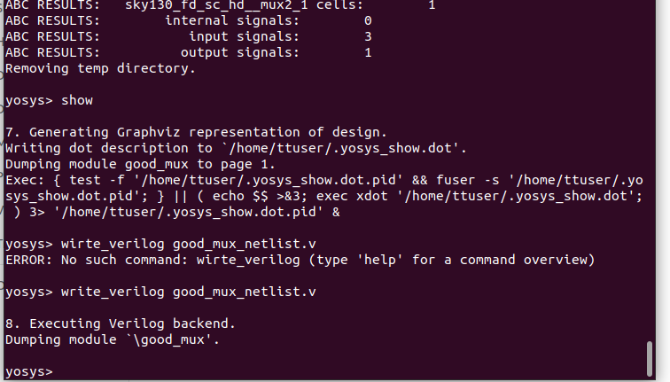
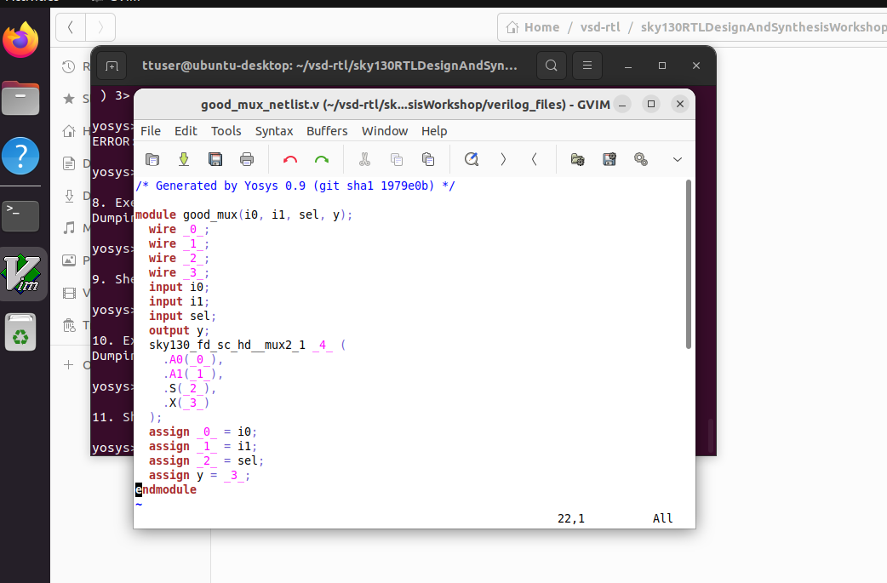
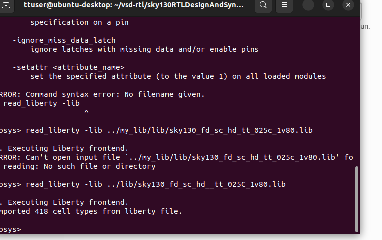
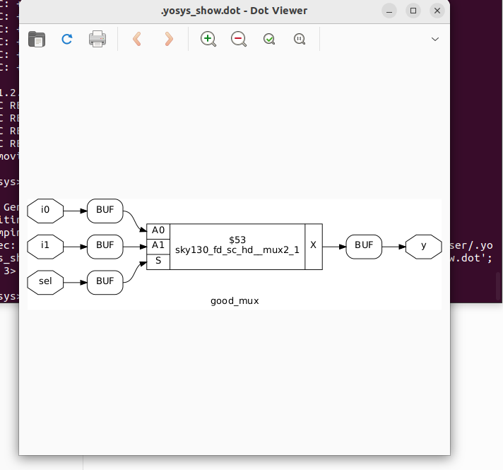
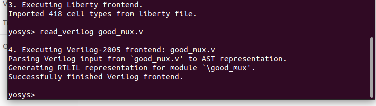
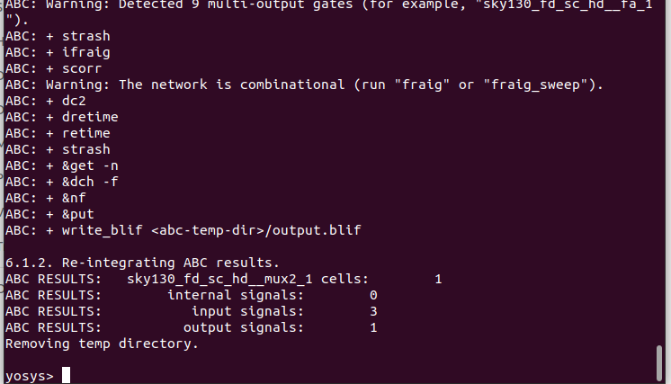
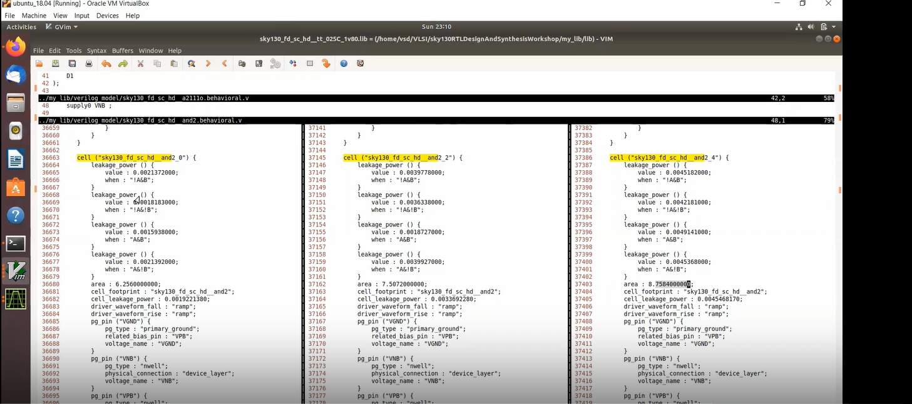
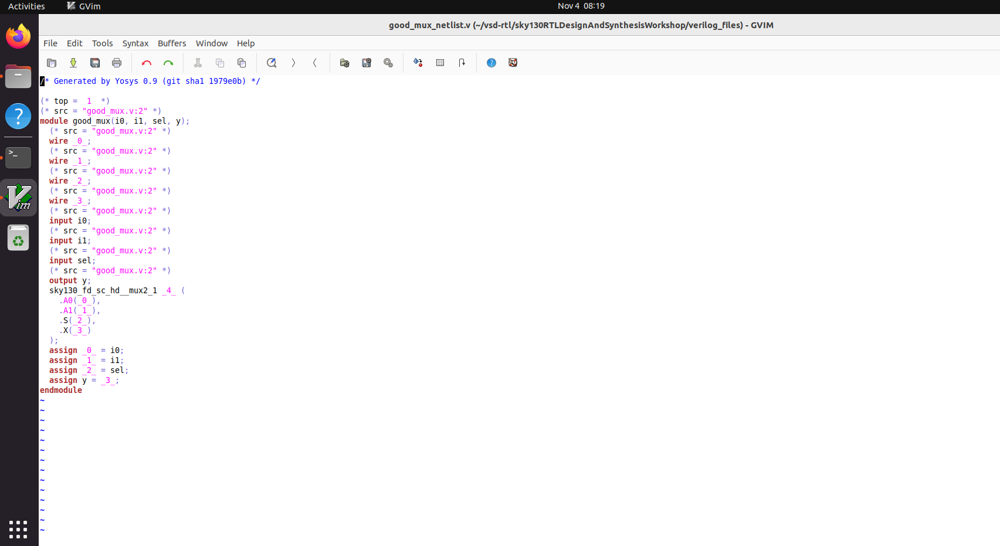

# Lab 3: Yosys synthesis, ABC mapping and netlists

**Evidence:** 8 supplied screenshot(s).

## Learning record

The topic is inferred from the uploaded screenshot names and, where available, the terminal logs. The source Verilog files themselves were not included in the ZIP.

## Commands and log evidence

No lab-specific terminal log was supplied. Screenshots document the experiment; no unverified commands have been attributed to this lab.

## Screenshots, in sequence

### 1. LAb3 Dumping netlist

*Evidence: `LAb3_Dumping_netlist.png`*

### 2. LAb3 without attr

*Evidence: `LAb3_without_attr.png`*

### 3. Lab3

*Evidence: `Lab3.png`*

### 4. Lab3 Show

*Evidence: `Lab3_Show.png`*

### 5. Lab3 Verilog files

*Evidence: `Lab3_Verilog_files.png`*

### 6. Lab3 abc command

*Evidence: `Lab3_abc_command.png`*

### 7. Lab3 gate comparison

*Evidence: `Lab3_gate_comparison.png`*

### 8. Lab3 good mux netlist.v

*Evidence: `Lab3_good_mux_netlist.v.png`*

## Observations and interpretation

- Focus: Yosys synthesis, ABC mapping and netlists.
- Screenshots and raw logs are retained as experimental evidence.
- Cell-level or waveform-specific results should be checked directly against the screenshots; no pass/fail result has been inferred from filenames alone.
