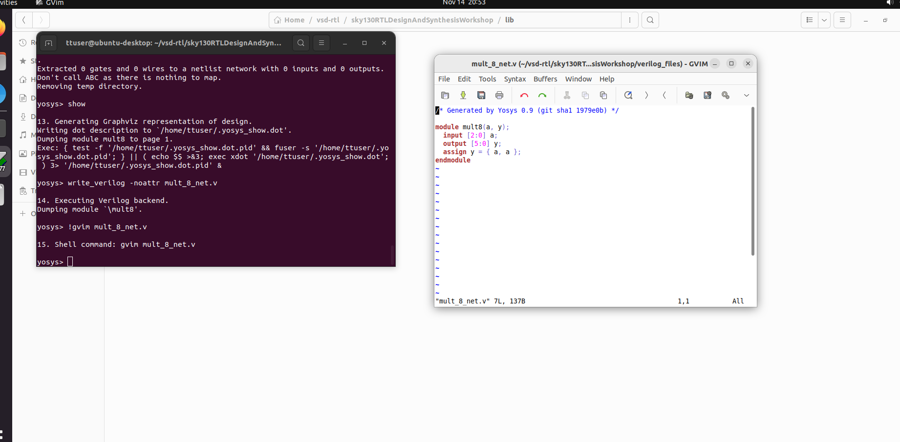
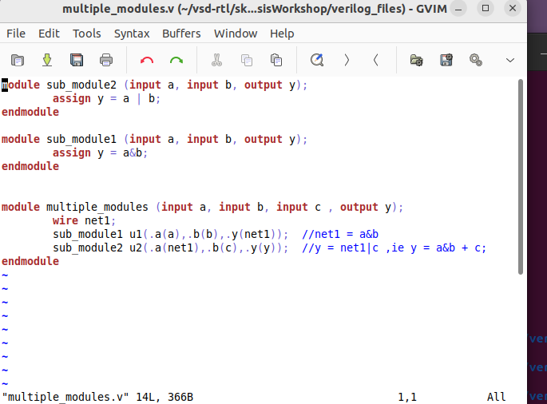
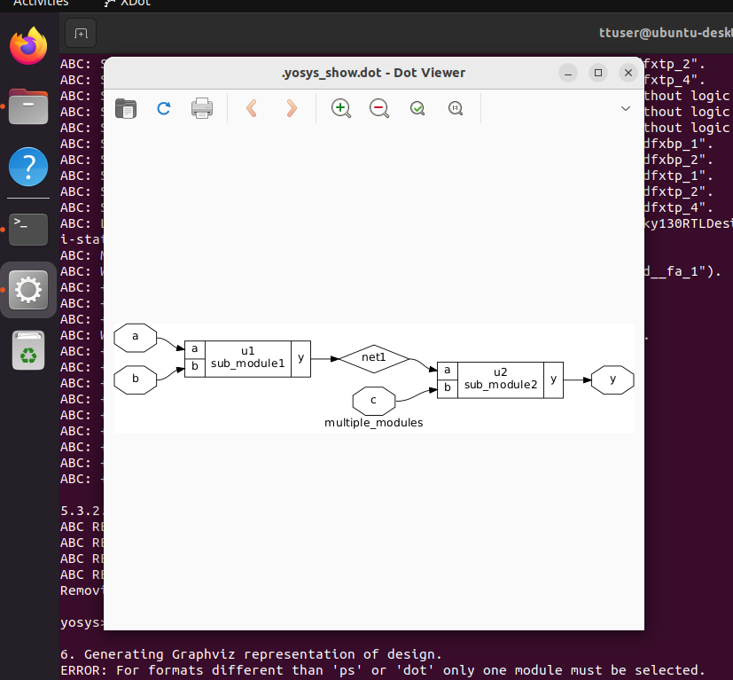
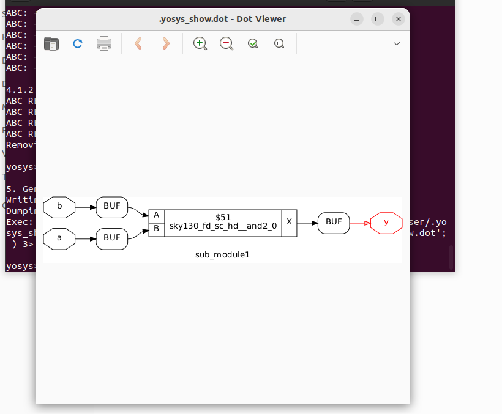

# Lab 4: Hierarchical versus flattened synthesis

**Evidence:** 7 supplied screenshot(s).

## Learning record

The topic is inferred from the uploaded screenshot names and, where available, the terminal logs. The source Verilog files themselves were not included in the ZIP.

## Commands and log evidence

Commands appearing in the supplied terminal history (some attempts may have failed; see raw log):

```console
gvim multiple_module.v
gvim multiple_modules.v
synth -top multiple_modules.v
read_verilog multiple_modules.v
synth -top multiple_module
synth -top multiple_modules
show multiple_modules
write_verilog multiple_modules_hier.v
!gvim multiple_modules_hier.v
write_verilog -noattr  multiple_modules_hier.v
read_liberty -lib ../lib/sky130_fd_sc_hd__tt_025C_1v80.lib
abc -liberty ../lib/sky130_fd_sc_hd__tt_025C_1v80.lib
show
```

Raw command history (includes full tool output): `logs/Logs_lab4_pt1.txt`

## Screenshots, in sequence

### 1. Flatten without sub moudles lab 4


*Evidence: `Flatten_without sub_moudles_lab_4.png`*

### 2. Lab4=5



*Evidence: `Lab4=5.png`*

### 3. Lab4 Multiple modules.v



*Evidence: `Lab4_Multiple_modules.v.png`*

### 4. Lab4 flatten and synth hier comparison of multiple modukes files


*Evidence: `Lab4_flatten and synth hier comparison of multiple_modukes_files.png`*

### 5. Multiple module netlist file without attribute lab4


*Evidence: `Multiple_module_netlist file without attribute_lab4.png`*

### 6. Yosys Multiple modules lab4



*Evidence: `Yosys_Multiple_modules_lab4.png`*

### 7. submodules synthesis



*Evidence: `submodules_synthesis.png`*

## Observations and interpretation

- Focus: Hierarchical versus flattened synthesis.
- Screenshots and raw logs are retained as experimental evidence.
- Cell-level or waveform-specific results should be checked directly against the screenshots; no pass/fail result has been inferred from filenames alone.
