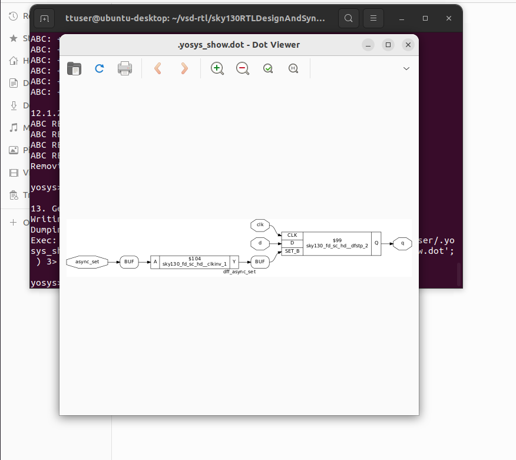
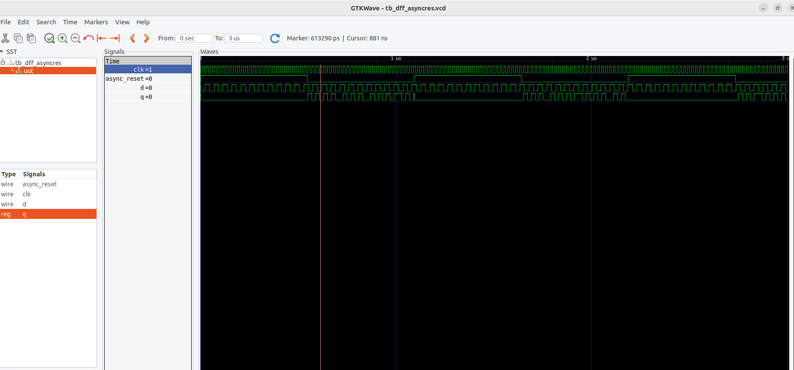
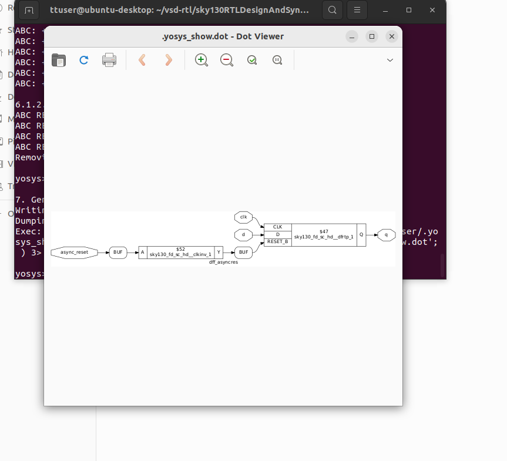
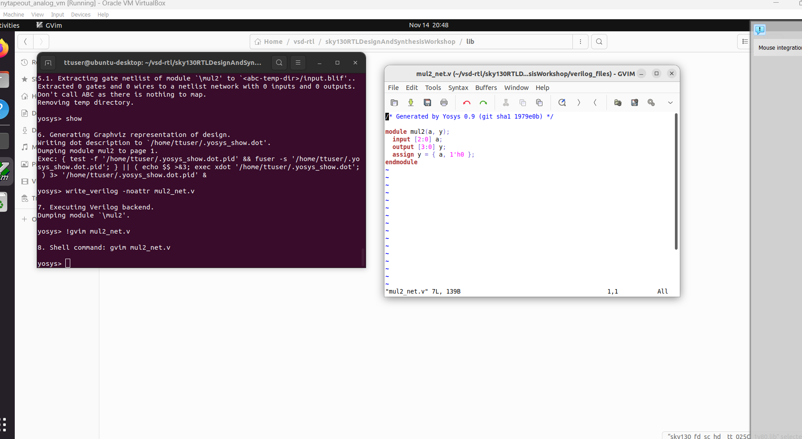
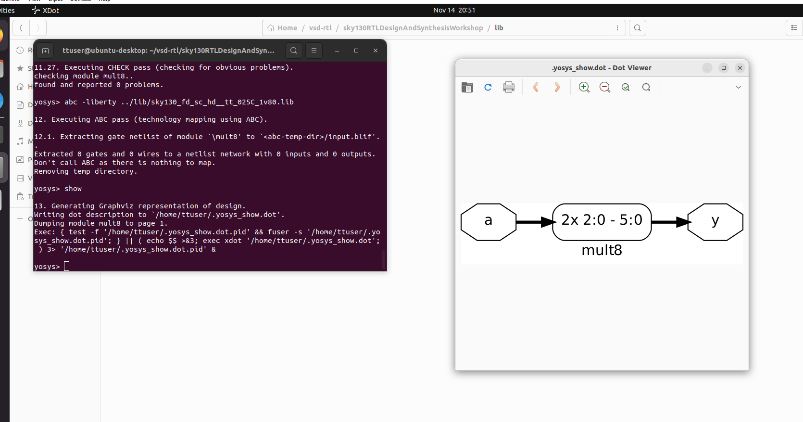
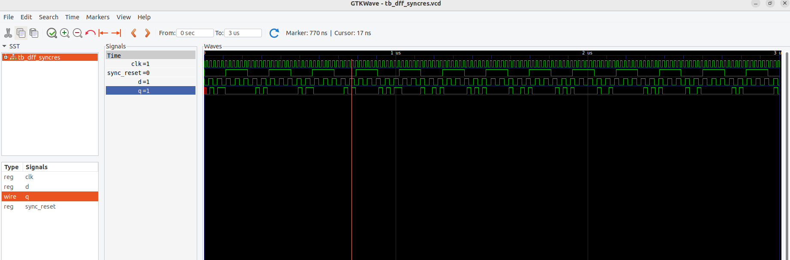
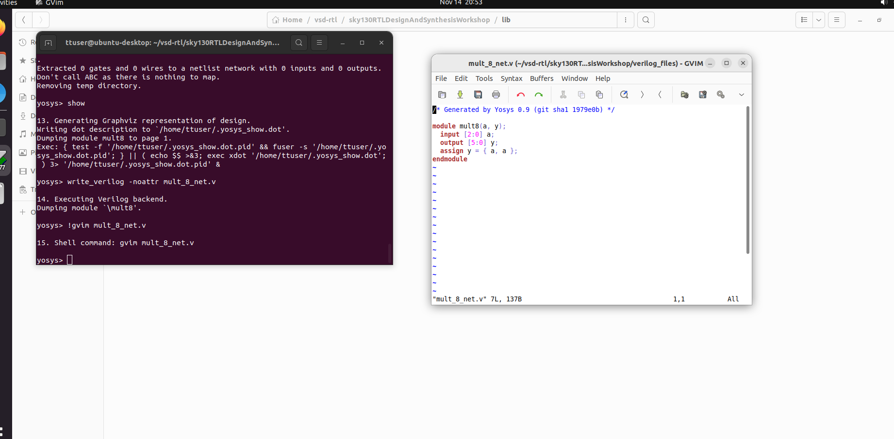
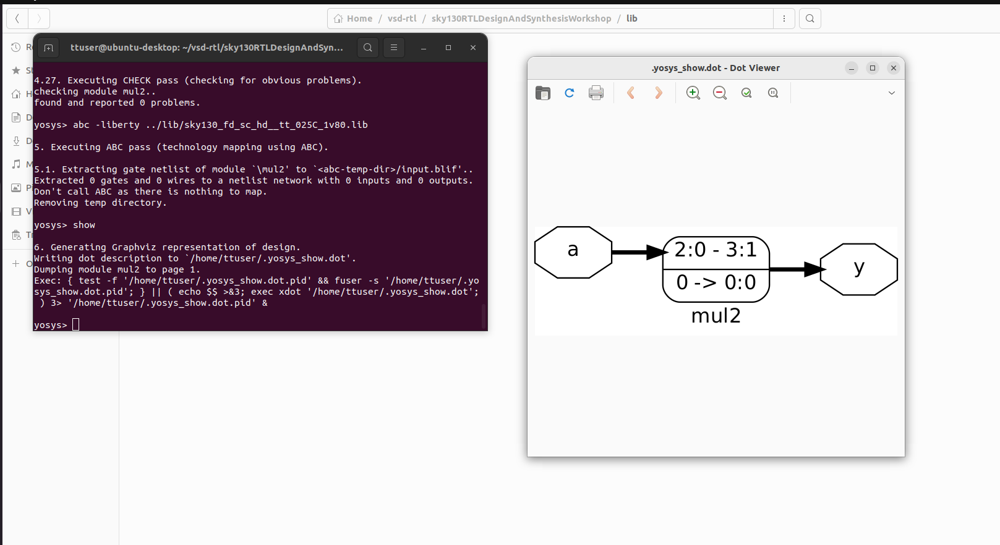
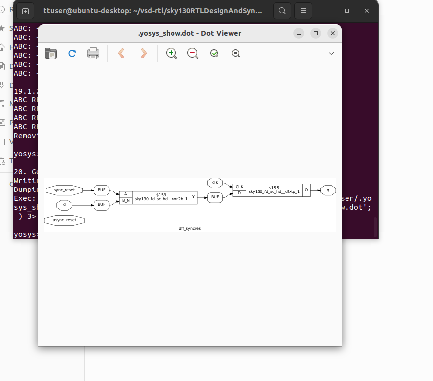

# Lab 5: Flip-flops, asynchronous/synchronous reset and multiplication optimization

**Evidence:** 10 supplied screenshot(s).

## Learning record

The topic is inferred from the uploaded screenshot names and, where available, the terminal logs. The source Verilog files themselves were not included in the ZIP.

## Commands and log evidence

No lab-specific terminal log was supplied. Screenshots document the experiment; no unverified commands have been attributed to this lab.

## Screenshots, in sequence

### 1. Async set lab5

*Evidence: `Async_set_lab5.png`*

### 2. Asynchronous Dff lab5 asynchronousreset

*Evidence: `Asynchronous_Dff_lab5_asynchronousreset.png`*

### 3. Asyncres lab 5

*Evidence: `Asyncres_lab_5.png`*

### 4. Lab5 Interesting Optmiztion Netlist mult2

*Evidence: `Lab5_Interesting_Optmiztion_Netlist_mult2.png`*

### 5. Lab5 Intersting optimization mul8

*Evidence: `Lab5_Intersting_optimization_mul8.png`*

### 6. Lab5 syschronous rset

*Evidence: `Lab5_syschronous_rset.png`*

### 7. Lab 5 asysnc set wave form

*Evidence: `Lab_5 asysnc_set_wave_form.png`*

### 8. Lab 5 Interesting Optimization mult8 netlist

*Evidence: `Lab_5_Interesting_Optimization_mult8_netlist.png`*

### 9. Lab interesting optimixation0f mult2

*Evidence: `Lab_interesting_optimixation0f_mult2.png`*

### 10. Sync reset lab5

*Evidence: `Sync_reset_lab5.png`*

## Observations and interpretation

- Focus: Flip-flops, asynchronous/synchronous reset and multiplication optimization.
- Screenshots and raw logs are retained as experimental evidence.
- Cell-level or waveform-specific results should be checked directly against the screenshots; no pass/fail result has been inferred from filenames alone.
