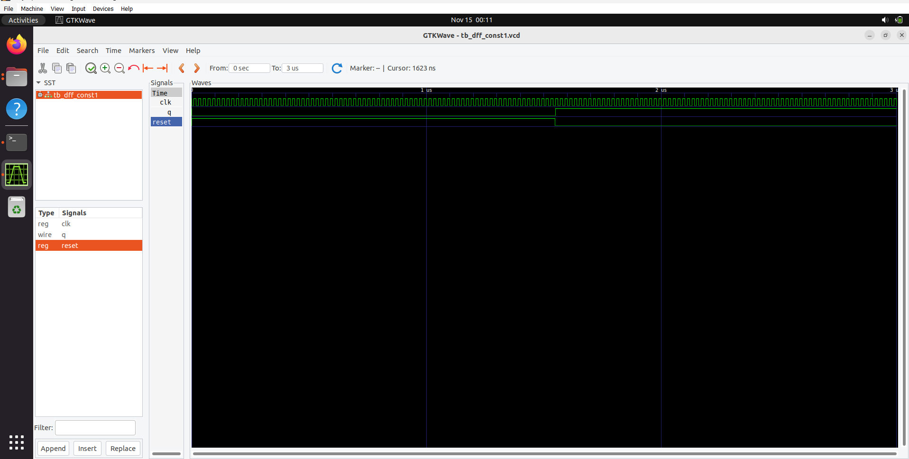
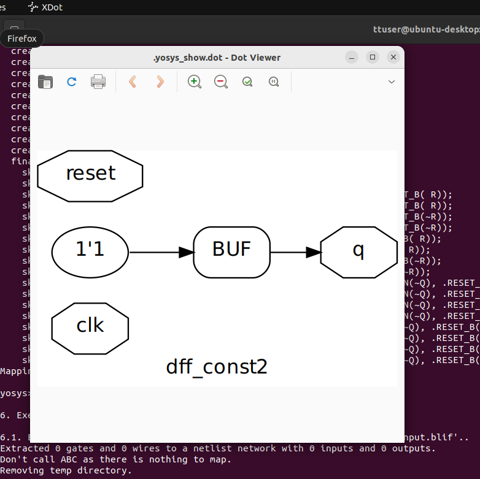
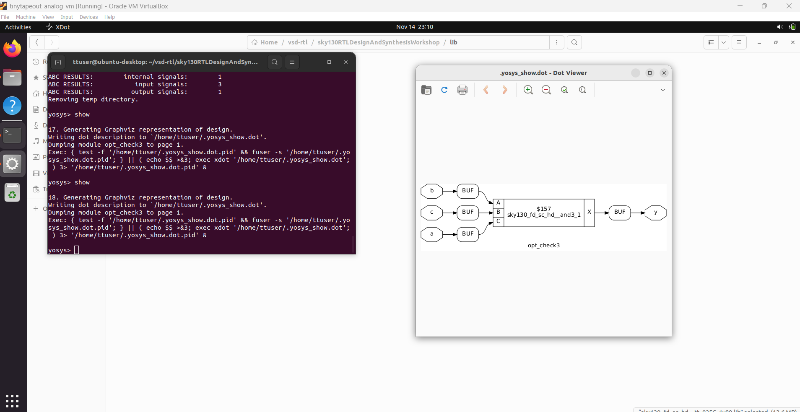
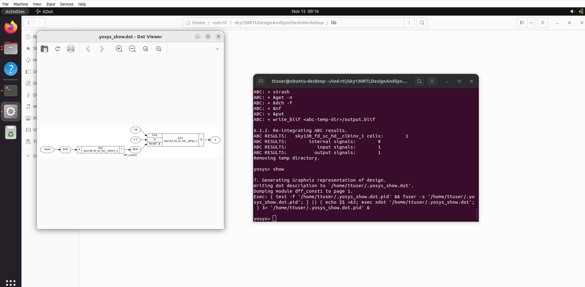
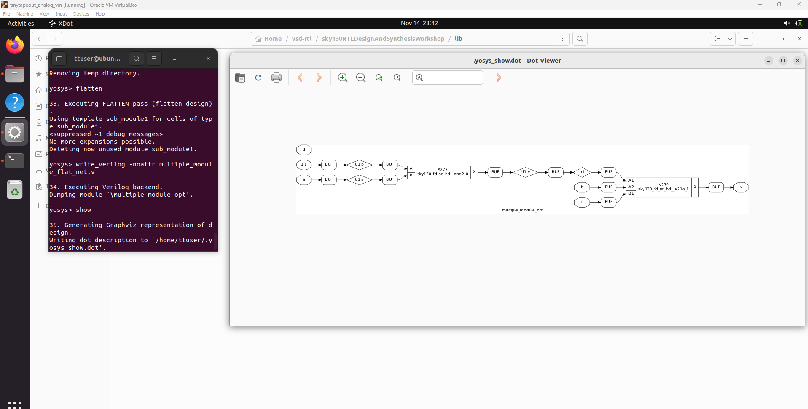
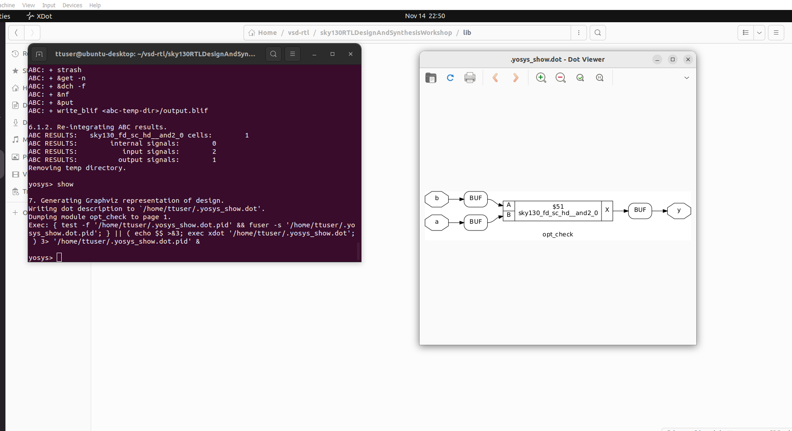
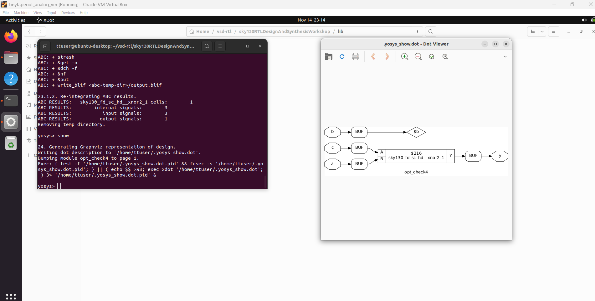
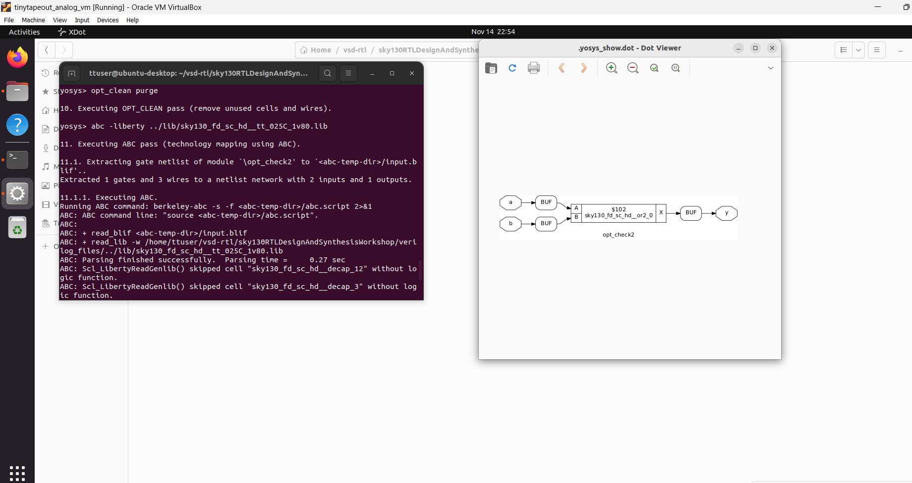
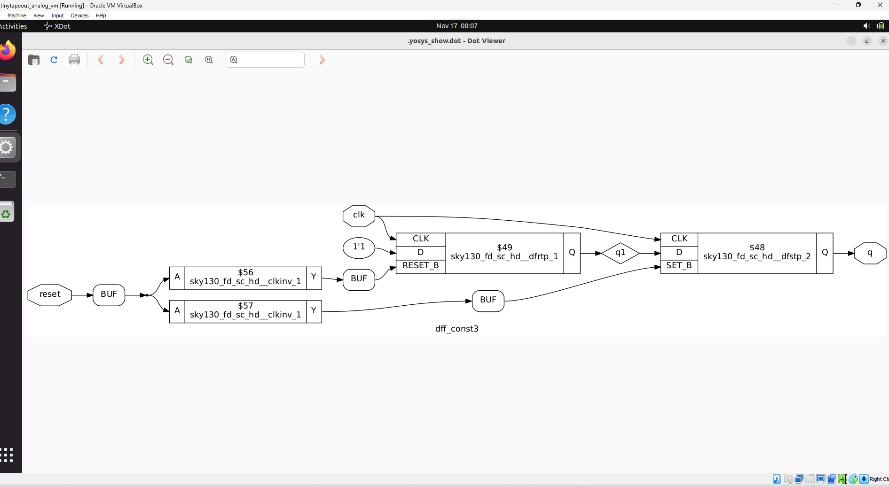
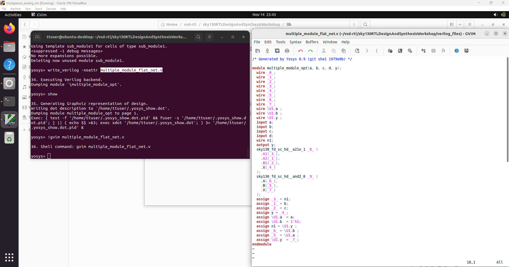

# Lab 6: Constant propagation and sequential optimization

**Evidence:** 12 supplied screenshot(s).

## Learning record

The topic is inferred from the uploaded screenshot names and, where available, the terminal logs. The source Verilog files themselves were not included in the ZIP.

## Commands and log evidence

Commands appearing in the supplied terminal history (some attempts may have failed; see raw log):

```console
iverilog dff_cont3.v
iverilog dff_const3.v
iverilog dff_const3.v tb_dff_const3.v
gtkwave tb_dff_const3.vcd
read_verilog dff_const3.v
synth -top dff_cont3
synth -top dff_const3
./a.out
read_liberty -lib ../lib/sky130_fd_sc_hd__tt_025C_1v80.lib
show
dfflibmap -lib ../lib/sky130_fd_sc_hd__tt_025C_1v80.lib
dfflibmap -liberty  ../lib/sky130_fd_sc_hd__tt_025C_1v80.lib
abc -liberty ../lib/sky130_fd_sc_hd__tt_025C_1v80.lib
dfflibmap -liberty ../lib/sky130_fd_sc_hd__tt_025C_1v80.lib
read_liberty libe ../lib/sky130_fd_sc_hd__tt_025C_1v80.lib
read_liberty lib ../lib/sky130_fd_sc_hd__tt_025C_1v80.lib
read_liberty  ../lib/sky130_fd_sc_hd__tt_025C_1v80.lib
```

Raw command history (includes full tool output): `logs/Till_lab7.txt`

## Screenshots, in sequence

### 1. Lab6 dff Const1 reset Wave



*Evidence: `Lab6_dff_Const1_reset_Wave.png`*

### 2. Lab6 dff const2 synthesis mdodule



*Evidence: `Lab6_dff_const2_synthesis_mdodule.png`*

### 3. Lab6 opt check 3 3input andgate



*Evidence: `Lab6_opt_check_3_3input_andgate.png`*

### 4. Lab 6Dff synthesis dff Const2 with contannts Q


*Evidence: `Lab_6Dff_synthesis_dff_Const2_with contannts_Q.png`*

### 5. Lab 6 Dff Systhesis diagram dff Const 1



*Evidence: `Lab_6_Dff_Systhesis_diagram_dff_Const_1.png`*

### 6. Lab 6 Dff const3 wave form


*Evidence: `Lab_6_Dff_const3 wave form.png`*

### 7. Lab 6 Multiple modules opt with flatten



*Evidence: `Lab_6_Multiple_modules_opt_with_flatten.png`*

### 8. Lab 6 Optcheck



*Evidence: `Lab_6_Optcheck.png`*

### 9. Lab 6 opt Check 4 optimization



*Evidence: `Lab_6_opt_Check_4_optimization.png`*

### 10. Lab 6 optimization opt check2



*Evidence: `Lab_6_optimization_opt_check2.png`*

### 11. Lab 6 synthesis of Dff const6



*Evidence: `Lab_6_synthesis_of_Dff_const6.png`*

### 12. lab 6 Multiple modules netlist



*Evidence: `lab_6_Multiple_modules_netlist.png`*

## Observations and interpretation

- Focus: Constant propagation and sequential optimization.
- Screenshots and raw logs are retained as experimental evidence.
- Cell-level or waveform-specific results should be checked directly against the screenshots; no pass/fail result has been inferred from filenames alone.
