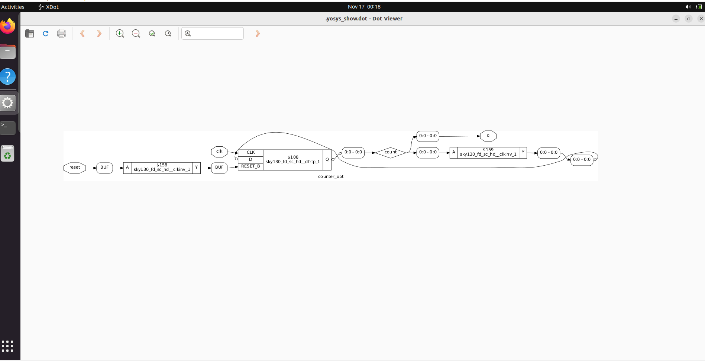
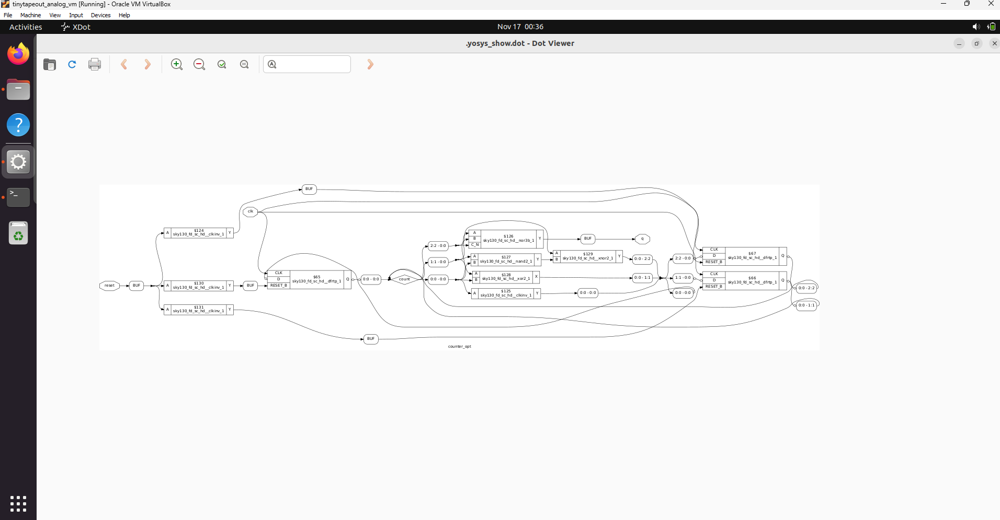

# Lab 7: Unused outputs and counter optimization

**Evidence:** 2 supplied screenshot(s).

## Learning record

The topic is inferred from the uploaded screenshot names and, where available, the terminal logs. The source Verilog files themselves were not included in the ZIP.

## Commands and log evidence

Commands appearing in the supplied terminal history (some attempts may have failed; see raw log):

```console
read_verilog counter_opt.v
synth -top counter_opt
!gvim  counter_opt2.v
read_verilog counter_opt2.v
synth -top counter_opt2.v
synth -top counter_opt2
./a.out
read_liberty -lib ../lib/sky130_fd_sc_hd__tt_025C_1v80.lib
show
dfflibmap -lib ../lib/sky130_fd_sc_hd__tt_025C_1v80.lib
dfflibmap -liberty  ../lib/sky130_fd_sc_hd__tt_025C_1v80.lib
abc -liberty ../lib/sky130_fd_sc_hd__tt_025C_1v80.lib
dfflibmap -liberty ../lib/sky130_fd_sc_hd__tt_025C_1v80.lib
read_liberty libe ../lib/sky130_fd_sc_hd__tt_025C_1v80.lib
read_liberty lib ../lib/sky130_fd_sc_hd__tt_025C_1v80.lib
read_liberty  ../lib/sky130_fd_sc_hd__tt_025C_1v80.lib
```

Raw command history (includes full tool output): `logs/Till_lab7.txt`

## Screenshots, in sequence

### 1. Lab7 Unused optimization dff counter.opt



*Evidence: `Lab7_Unused__optimization_dff_counter.opt.png`*

### 2. lab7 unused output optimization opt counter 2



*Evidence: `lab7_unused_output_optimization_opt_counter_2.png`*

## Observations and interpretation

- Focus: Unused outputs and counter optimization.
- Screenshots and raw logs are retained as experimental evidence.
- Cell-level or waveform-specific results should be checked directly against the screenshots; no pass/fail result has been inferred from filenames alone.
