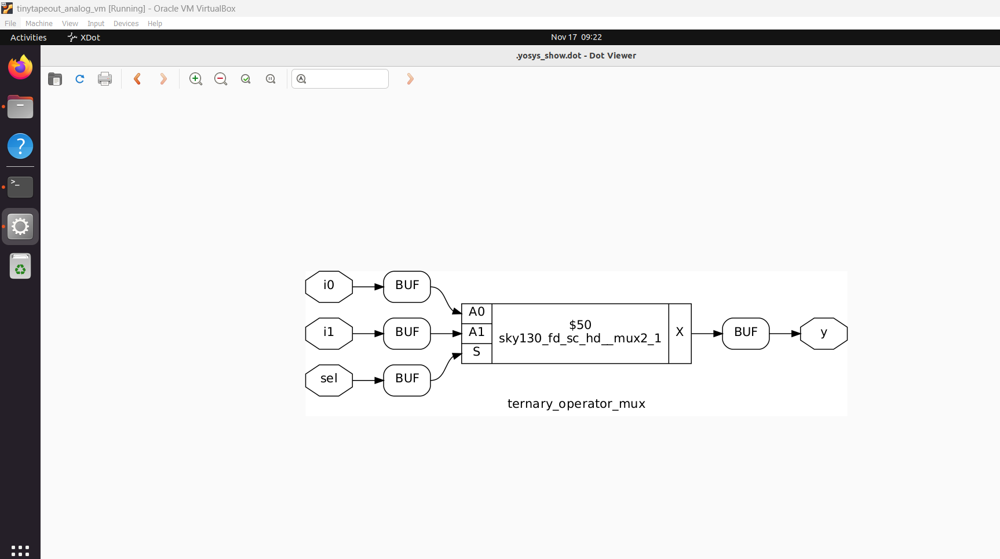
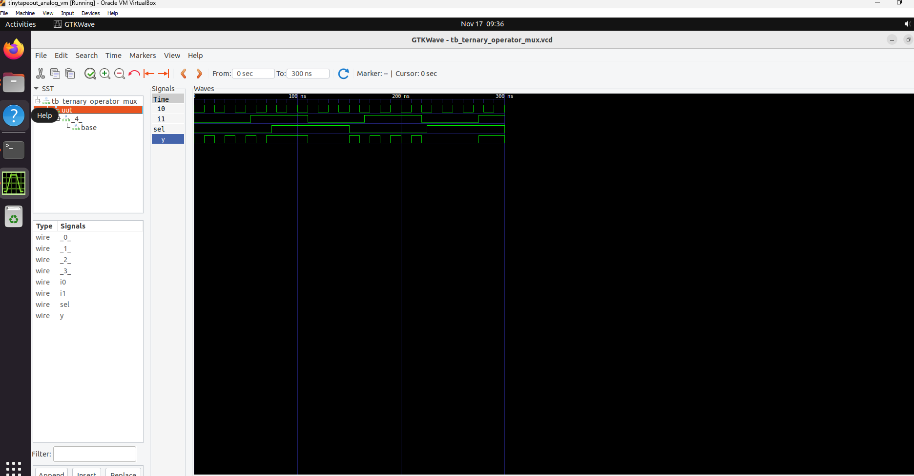
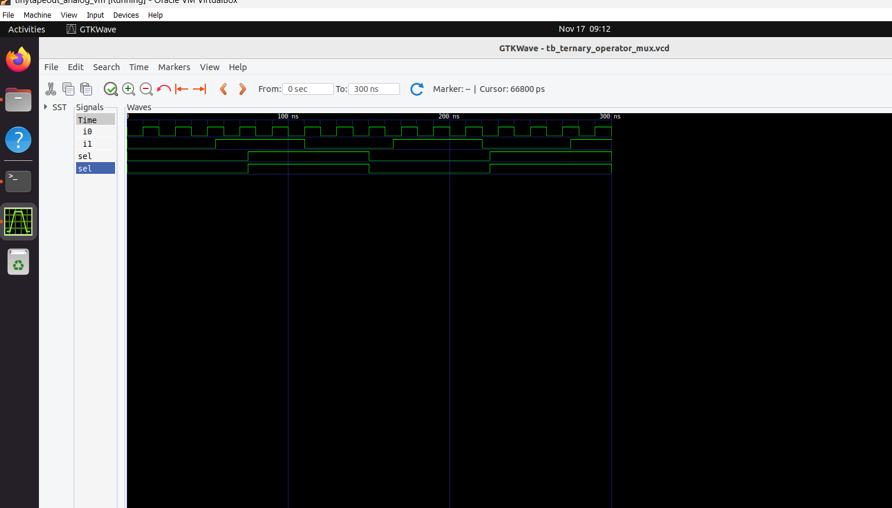
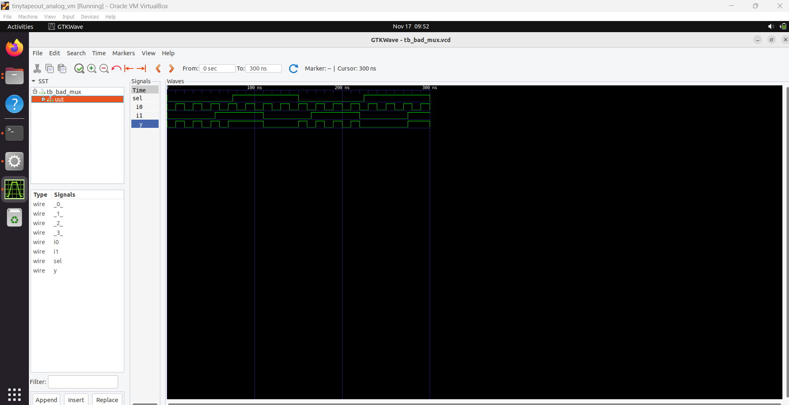
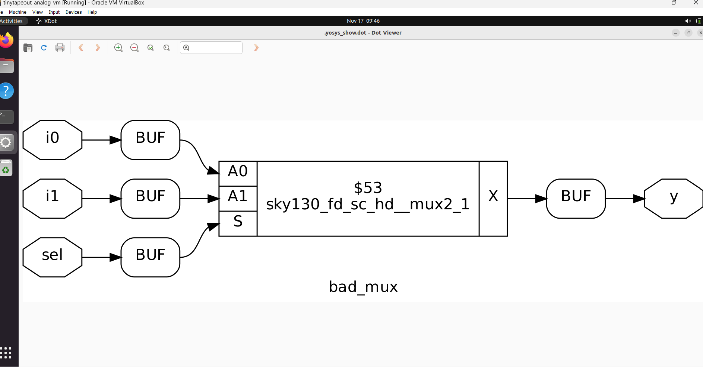
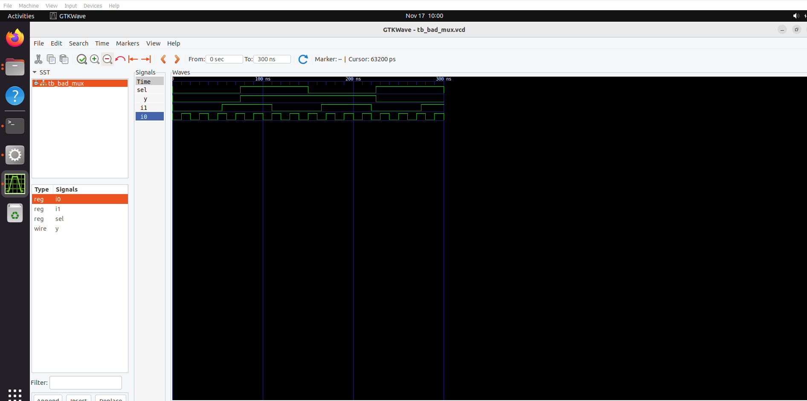
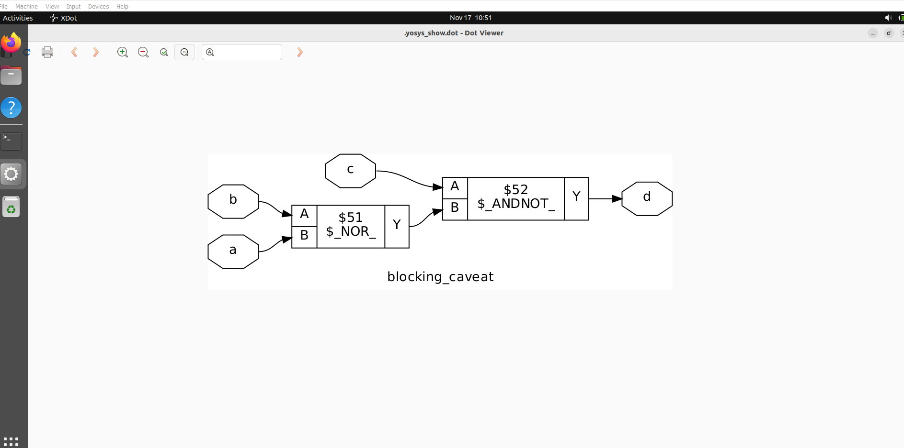
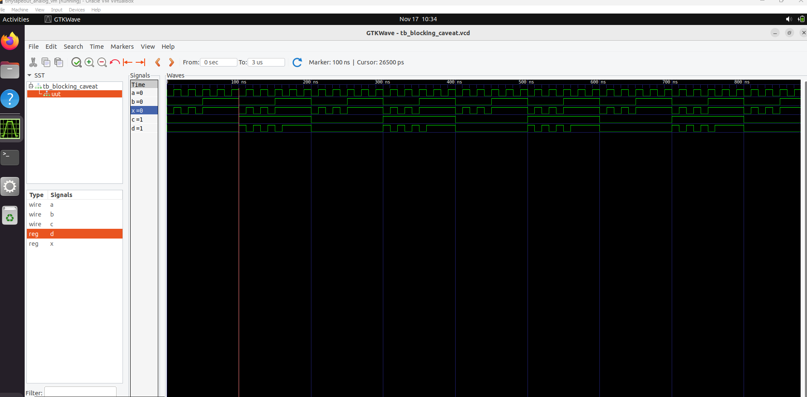
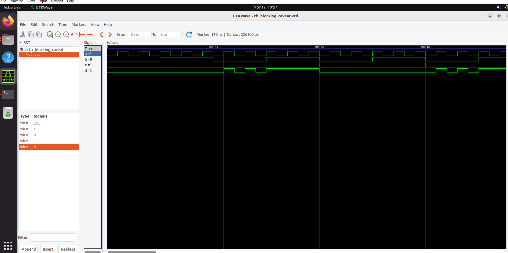

# Lab 8: Ternary muxes, blocking caveat and gate-level simulation

**Evidence:** 10 supplied screenshot(s).

## Learning record

The topic is inferred from the uploaded screenshot names and, where available, the terminal logs. The source Verilog files themselves were not included in the ZIP.

## Commands and log evidence

Commands appearing in the supplied terminal history (some attempts may have failed; see raw log):

```console
iverilog ternary_operator_mux.v  tb_ternary_operator_mux.v
gtkwave tb_ternary_operator_mux.vcd
read_verilog ternary_operator_mux.v
synth -top ternary_operator_mux
write_verilog -noattr ternary_operator_mux.net
iverilog ../my_lib/verilog_model/primitives.v ../my_lib/verilog_model/sky130_fd_sc_hd.v ternary_operator_mux.net.v tb_ternary_operator_mux.v
iverilog ../my_lib/verilog_model/primitives.v ../my_lib/verilog_model/sky130_fd_sc_hd.v ternary_operator_mux.net.v tb_terttuser@ubuntu-desktop:~/vsd-rtl/sky130RTLDesignAndSynthesisWorkshop/verilog_files$ yosys
write_verilog -noattr ternary_operator_mux_net.v
iverilog ../my_lib/verilog_model/primitives.v ../my_lib/verilog_model/sky130_fd_sc_hd.v ternary_operator_mux_net.v tb_ternary_operator_mux.v
iverilog bad_mux.v
iverilog bad_mux.v tb_bad_mux.v
gtkwave tb_bad_mux.vcd
read_verilog bad_mux.v
synth -top bad_mux
write_verilog -noattr bad_mux_net.v
iverilog iverilog ../my_lib/verilog_model/primitives.v ../my_lib/verilog_model/sky130_fd_sc_hd.v bad_mux_net.v tb_bad_mux.v
iverilog ../my_lib/verilog_model/primitives.v ../my_lib/verilog_model/sky130_fd_sc_hd.v bad_mux_net.v tb_bad_mux.v
!iverilog ../my_lib/verilog_model/primitives.v ../my_lib/verilog_model/sky130_fd_sc_hd.v bad_mux_net.v tb_bad_mux.v
!gtkwave tb_bad_mux.vcd
iverilog blocking_caveat.v tb_blocking_caveat.v
gtkwave tb_blocking_caveat.vcd
read_verilog blocking_caveat.v
synth -top blocking_caveat
write_verilog -noaatr blocking_caveat_net.v
write_verilog -noattr blocking_caveat_net.v
!iverilog ../my_lib/verilog_model/primitives.v ../my_lib/verilog_model/sky130_fd_sc_hd.v blocking_caveat_net.v tb_blocking_caveat.v
!gtkwave tb_blocking_caveat.vcd
./a.out
read_liberty -lib ../lib/sky130_fd_sc_hd__tt_025C_1v80.lib
abc -liberty ../lib/sky130_fd_sc_hd__tt_025C_1v80.lib
show
abc -liberty ../lib/ sky130_fd_sc_hd__tt_025C_1v80.lib
```

Raw command history (includes full tool output): `logs/Lab_8.txt`

## Screenshots, in sequence

### 1. Lab8 Termary operator 2 1 mux for operator



*Evidence: `Lab8_Termary_operator_2_1_mux_for_operator.png`*

### 2. Lab8 gls simulation ternary operator



*Evidence: `Lab8_gls_simulation_ternary_operator.png`*

### 3. Lab 8 Blocking caveat GLS


*Evidence: `Lab_8_Blocking_caveat_GLS.png`*

### 4. Lab 8 GLS Ternary operator waveform



*Evidence: `Lab_8_GLS_Ternary_operator_waveform.png`*

### 5. Lab 8 bad mux gls wave form



*Evidence: `Lab_8_bad_mux_gls_wave_form.png`*

### 6. Lab 8 bad mux sysnthesis



*Evidence: `Lab_8_bad_mux_sysnthesis.png`*

### 7. Lab 8 bad mux wave form



*Evidence: `Lab_8_bad_mux_wave_form.png`*

### 8. Lab 8 blocking caveat Synthesis



*Evidence: `Lab_8_blocking_caveat_Synthesis.png`*

### 9. Lab 8 blocking caveat waveform



*Evidence: `Lab_8_blocking_caveat_waveform.png`*

### 10. Lab 8 week



*Evidence: `Lab_8_week.png`*

## Observations and interpretation

- Focus: Ternary muxes, blocking caveat and gate-level simulation.
- Screenshots and raw logs are retained as experimental evidence.
- Cell-level or waveform-specific results should be checked directly against the screenshots; no pass/fail result has been inferred from filenames alone.
