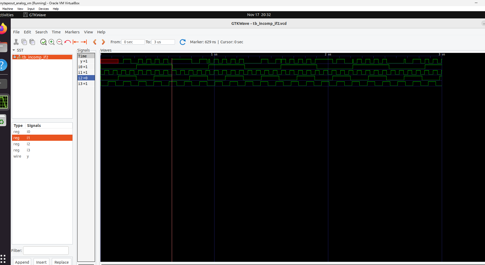
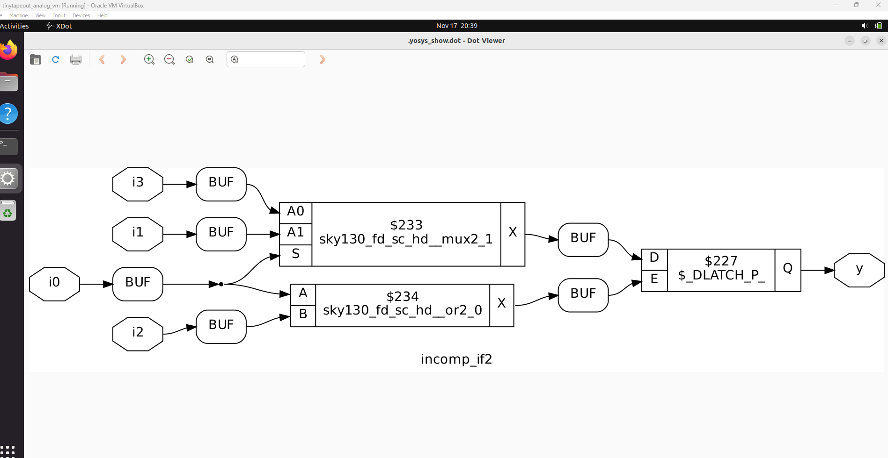
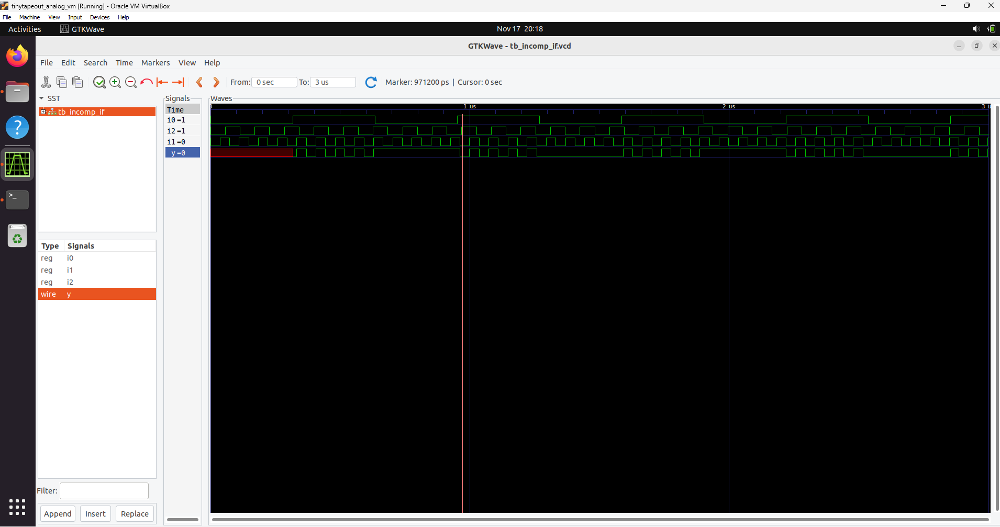
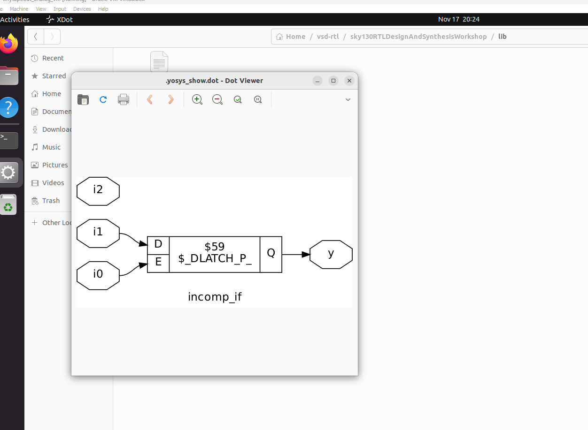

# Lab 9: Incomplete if statements and inferred latches

**Evidence:** 4 supplied screenshot(s).

## Learning record

The topic is inferred from the uploaded screenshot names and, where available, the terminal logs. The source Verilog files themselves were not included in the ZIP.

## Commands and log evidence

No lab-specific terminal log was supplied. Screenshots document the experiment; no unverified commands have been attributed to this lab.

## Screenshots, in sequence

### 1. Lab 9 incomp if2 gtkwaveform

*Evidence: `Lab_9_incomp_if2_gtkwaveform.png`*

### 2. Lab 9 incomp if2 synthesis

*Evidence: `Lab_9_incomp_if2_synthesis.png`*

### 3. Lab 9 incomp if waveform

*Evidence: `Lab_9_incomp_if_waveform.png`*

### 4. Lab 9 sysnthesis of Incomp if as latch

*Evidence: `Lab_9_sysnthesis_of_Incomp_if_as_latch.png`*

## Observations and interpretation

- Focus: Incomplete if statements and inferred latches.
- Screenshots and raw logs are retained as experimental evidence.
- Cell-level or waveform-specific results should be checked directly against the screenshots; no pass/fail result has been inferred from filenames alone.
