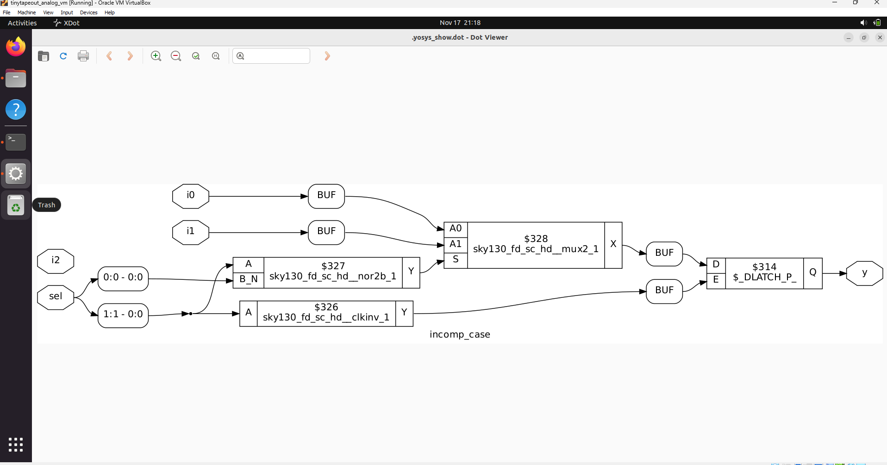
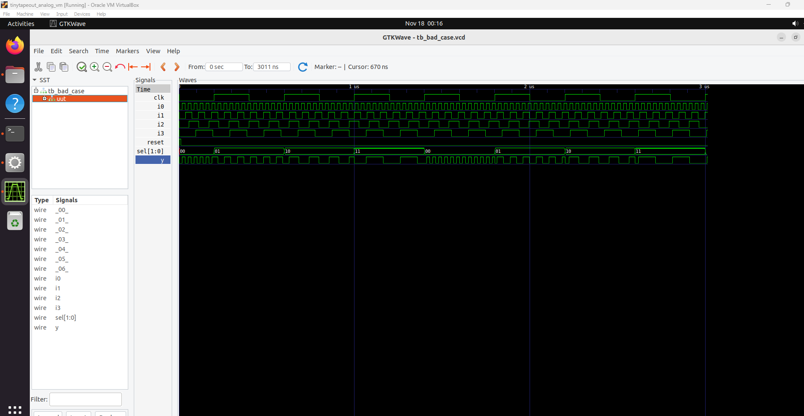
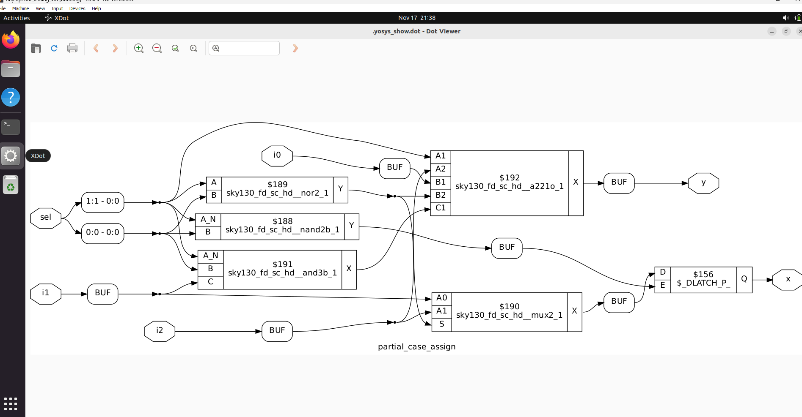
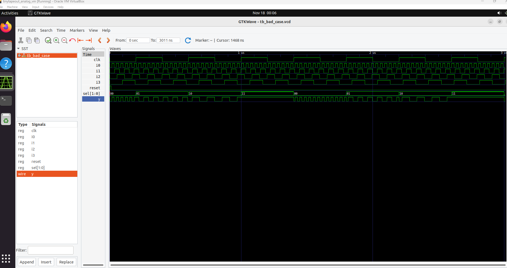
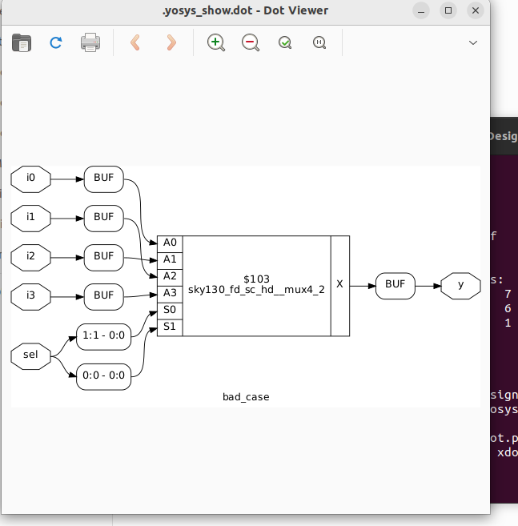
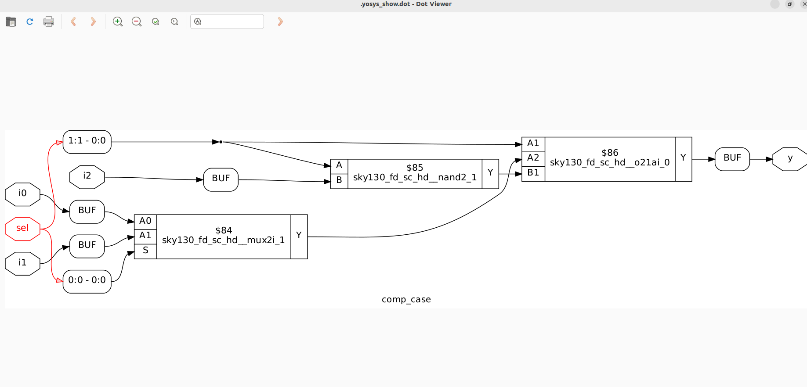
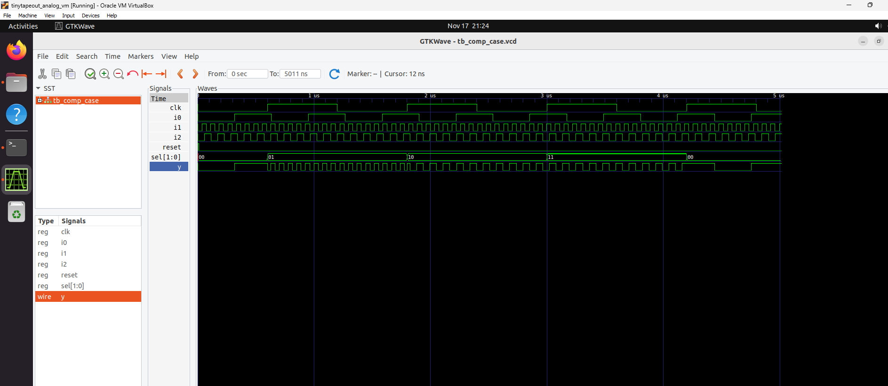
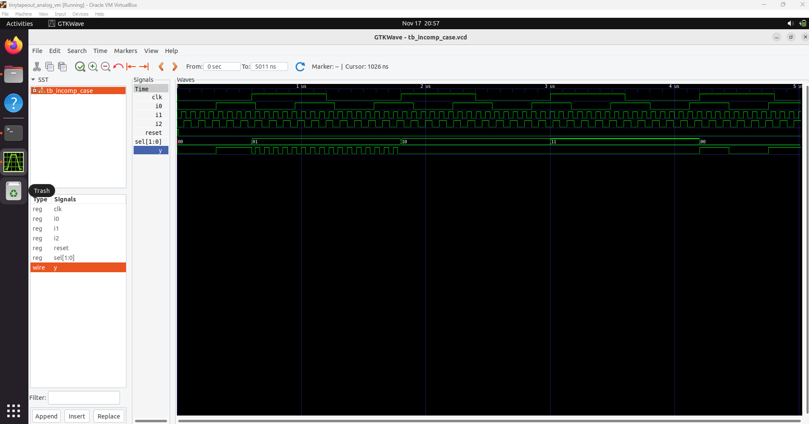

# Lab 10: Case statements: complete, incomplete, partial and bad cases

**Evidence:** 9 supplied screenshot(s).

## Learning record

The topic is inferred from the uploaded screenshot names and, where available, the terminal logs. The source Verilog files themselves were not included in the ZIP.

## Commands and log evidence

Commands appearing in the supplied terminal history (some attempts may have failed; see raw log):

```console
iverilog bad_case.v tb_bad_case.v
gtkwave tb_bad_case.vcd
read_verilog bad_case.v
synth -top bad_case
write_verilog -noattr bad_case_net.v
!iverilog ../my_lib/verilog_model/primitives.v ../my_lib/verilog_model/sky130_fd_sc_hd.v bad_case_net.v  tb_bad_case.v
!gtkwave tb_bad_case.vcd
./a.out
read_liberty -lib ../lib/sky130_fd_sc_hd__tt_025C_1v80.lib
abc -liberty ../lib/sky130_fd_sc_hd__tt_025C_1v80.lib
show
read_liberty -lib sky130_fd_sc_hd__tt_025C_1v80.lib
read_liberty -lib../lib/ sky130_fd_sc_hd__tt_025C_1v80.lib
read_liberty -lib ../lib/ sky130_fd_sc_hd__tt_025C_1v80.lib
```

Raw command history (includes full tool output): `logs/Logs_lab11.txt`

## Screenshots, in sequence

### 1. Lab 10



*Evidence: `Lab_10.png`*

### 2. Lab 10 Gls bad Case waveform



*Evidence: `Lab_10_Gls_bad_Case_waveform.png`*

### 3. Lab 10 Partial case synth



*Evidence: `Lab_10_Partial_case_synth.png`*

### 4. Lab 10 bad Case wave form



*Evidence: `Lab_10_bad_Case_wave_form.png`*

### 5. Lab 10 bad case synthesis



*Evidence: `Lab_10_bad_case_synthesis.png`*

### 6. Lab 10 comp case synthesis



*Evidence: `Lab_10_comp_case_synthesis.png`*

### 7. Lab 10 comp case waveform



*Evidence: `Lab_10_comp_case_waveform.png`*

### 8. Lab 10 incomp case synthesis


*Evidence: `Lab_10_incomp_case_synthesis.png`*

### 9. Lab 10 incomp case waveform



*Evidence: `Lab_10_incomp_case_waveform.png`*

## Observations and interpretation

- Focus: Case statements: complete, incomplete, partial and bad cases.
- Screenshots and raw logs are retained as experimental evidence.
- Cell-level or waveform-specific results should be checked directly against the screenshots; no pass/fail result has been inferred from filenames alone.
