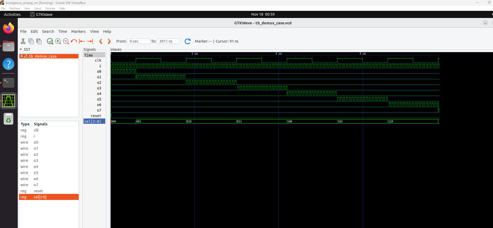
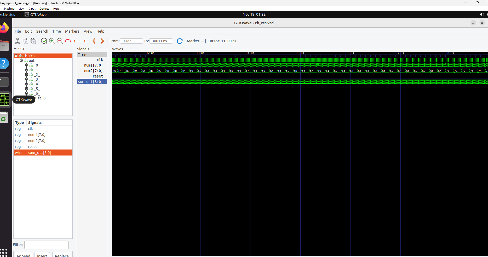
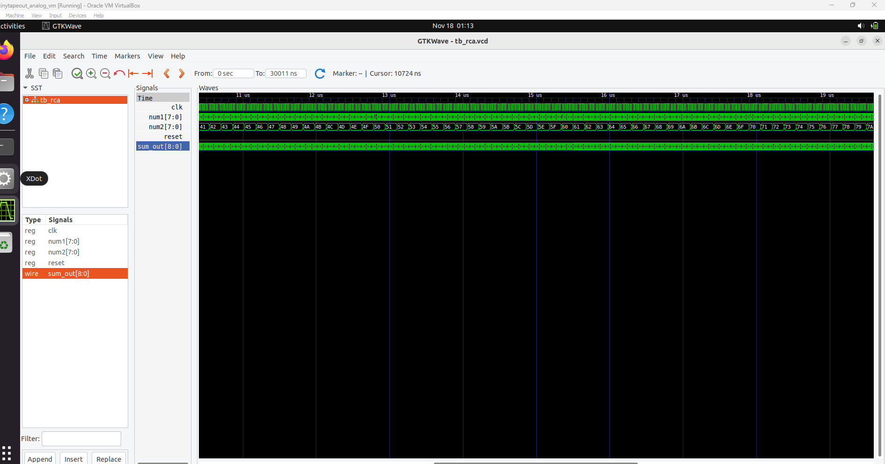
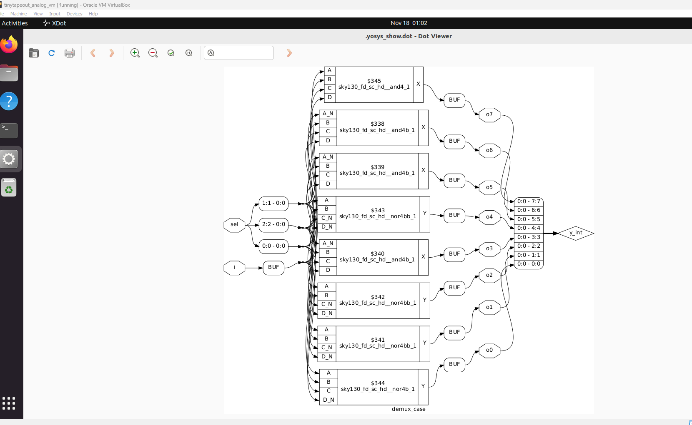
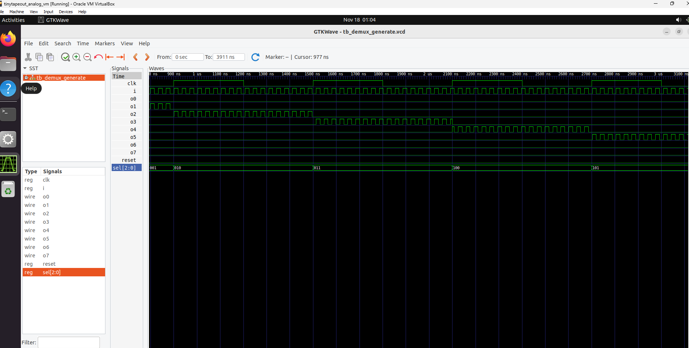
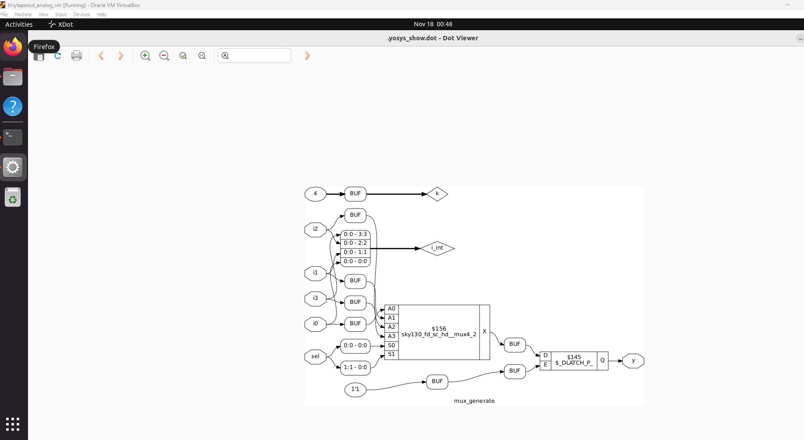
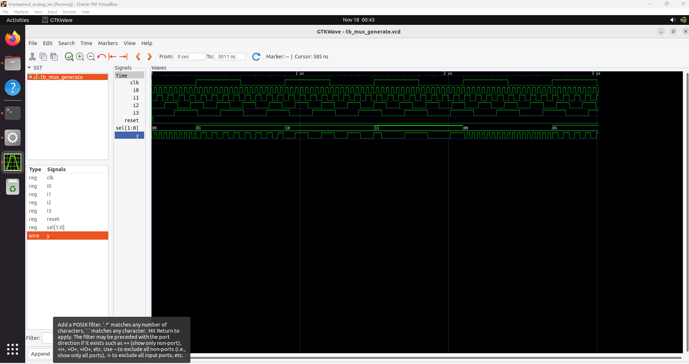
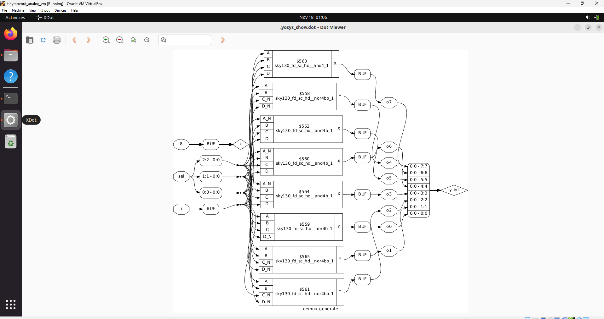

# Lab 11: Generated mux/demux, case demux and ripple-carry adder

**Evidence:** 9 supplied screenshot(s).

## Learning record

The topic is inferred from the uploaded screenshot names and, where available, the terminal logs. The source Verilog files themselves were not included in the ZIP.

## Commands and log evidence

Commands appearing in the supplied terminal history (some attempts may have failed; see raw log):

```console
iverilog mux_generate.v tb_mux_generate.v
gtkwave tb_mux_generate.vcd
read_verilog mux_generate.v
synth -top  mux_generate
write_verilog -noattr mux_generate_net.v
iverilog ../my_lib/verilog_model/primitives.v ../my_lib/verilog_model/sky130_fd_sc_hd.v mux_generate_net  tb_mux_generate.v
iverilog ../my_lib/verilog_model/primitives.v ../my_lib/verilog_model/sky130_fd_sc_hd.v mux_generate_net.v  tb_mux_generate.v
iverilog ../my_lib/verilog_model/primitives.v ../my_lib/verilog_model/sky130_fd_sc_hd.v mux_generate_net.v  tb_mux_generattuser@ubuntu-desktop:~/vsd-rtl/sky130RTLDesignAndSynthesisWorkshop/verilog_files$ yosys
synth -top mux_generate
!iverilog ../my_lib/verilog_model/primitives.v ../my_lib/verilog_model/sky130_fd_sc_hd.v mux_generate_net.v tb_mux_generate.v
iverilog demux_case.v tb_demux_case.v
gtkwave tb_demux_case.vcd
read_verilog demux_case.v
synth -top demux_case
!iverilog demux_generate.v tb_demux_generate.v
!gtkwave tb_demux_generate.vcd
read_verilog demux_generate.v
synth -top demux_generate
!iverilog rca.v tb_rca.v
!iverilog fa.v  rca.v tb_rca.v
!gtkwave tb_rca.vcd
read_verilog rca.v
synth -top rca
read_verilog fa.v rca.v
synth -top rca fa
write_verilog -noattr rca_net.v
!iverilog fa.v rca_net.v tb_rca.v
!iverilog  rca_net.v tb_rca.v
!iverilog ../my_lib/verilog_model/primitives.v ../my_lib/verilog_model/sky130_fd_sc_hd.v rca_net.v tb_rca.v
./a.out
read_liberty -lib ../lib/sky130_fd_sc_hd__tt_025C_1v80.lib
abc -liberty ../lib/sky130_fd_sc_hd__tt_025C_1v80.lib
show
read_liberty -lib sky130_fd_sc_hd__tt_025C_1v80.lib
read_liberty -lib../lib/ sky130_fd_sc_hd__tt_025C_1v80.lib
read_liberty -lib ../lib/ sky130_fd_sc_hd__tt_025C_1v80.lib
```

Raw command history (includes full tool output): `logs/Logs_lab11.txt`

## Screenshots, in sequence

### 1. Lab 11 Case demux wave Form



*Evidence: `Lab_11_Case_demux_wave_Form.png`*

### 2. Lab 11 GLS RCA WAVEFORM



*Evidence: `Lab_11_GLS_RCA_WAVEFORM.png`*

### 3. Lab 11 RCA Wave Form



*Evidence: `Lab_11_RCA_Wave_Form.png`*

### 4. Lab 11 case demux synthesis



*Evidence: `Lab_11_case_demux_synthesis.png`*

### 5. Lab 11 generate Demux Waveform



*Evidence: `Lab_11_generate_Demux_Waveform.png`*

### 6. Lab 11 mux generate synthesis



*Evidence: `Lab_11_mux_generate_synthesis.png`*

### 7. Lab 11 mux genetrate synthesis



*Evidence: `Lab_11_mux_genetrate_synthesis.png`*

### 8. Lab 11 rca synthesis


*Evidence: `Lab_11_rca_synthesis.png`*

### 9. lab 11 demux generate



*Evidence: `lab_11_demux_generate.png`*

## Observations and interpretation

- Focus: Generated mux/demux, case demux and ripple-carry adder.
- Screenshots and raw logs are retained as experimental evidence.
- Cell-level or waveform-specific results should be checked directly against the screenshots; no pass/fail result has been inferred from filenames alone.
